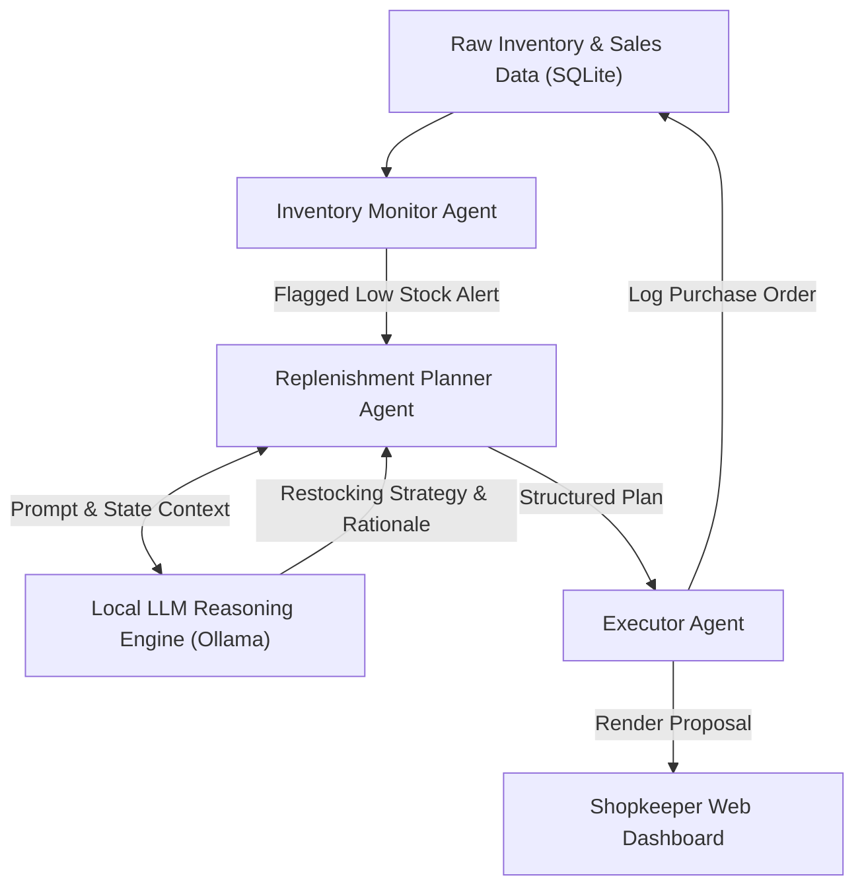

# 🤖 Agentic AI Projects — Smart Inventory Planning System

<p align="center">
  
</p>

<p align="center">
  An autonomous multi-agent inventory planning and replenishment architecture utilizing local Large Language Models (LLMs via Ollama) and a Flask/SQLite backend to reason over retail consumption velocity, predict stockouts, and formulate automated purchase recommendations.
</p>

<p align="center">
  <a href="https://github.com/prakruthidevanga/Agentic_AI_Projects">
    
  </a>
</p>

<p align="center">
  
  
  
  
</p>

---

## 📌 Table of Contents

- [📖 Project Overview](#-project-overview)
- [🎯 Objectives](#-objectives)
- [✨ Key Features](#-key-features)
- [🤖 Multi-Agent Architecture](#-multi-agent-architecture)
- [🏗️ System Workflow](#️-system-workflow)
- [🛠️ Technology Stack](#️-technology-stack)
- [📁 Repository Structure](#-repository-structure)
- [⚙️ Installation and Setup](#️-installation-and-setup)
- [🔮 Future Enhancements](#-future-enhancements)
- [🤝 Contributing](#-contributing)
- [👩‍💻 Author & Accreditations](#-author--accreditations)

---

## 📖 Project Overview

Smallholder retail operations frequently struggle with stockouts, overstocking, and unpredictable supplier lead times. Traditional inventory software relies on static reorder thresholds that fail to adapt to seasonality, demand spikes, or dynamic supplier constraints.

**Agentic AI Projects** introduces an autonomous multi-agent planning framework for intelligent inventory replenishment. By deploying collaborative specialized agents (Monitor, Planner, and Executor) backed by local LLM reasoning through **Ollama**, the system continuously monitors stock levels, synthesizes natural language restocking proposals, and generates purchase orders without relying on expensive proprietary cloud APIs.

🤖 **Core Mission:** Bring accessible, autonomous AI decision-making into local retail operations using open-source, local agentic workflows.

---

## 🎯 Objectives

- 🔍 **Real-Time Stock Velocity Tracking:** Continuously audit item depletion rates and lead times against safety buffer thresholds.
- 🧠 **Autonomous LLM Deliberation:** Employ local LLMs to reason over conflicting constraints (storage limits, bulk discounts, cash flow) and produce human-understandable rationale.
- 🔄 **Multi-Agent Collaboration:** Segment responsibilities across specialized agents rather than relying on a single monolithic prompt.
- 💾 **State Persistence:** Maintain structured historical state and order records in SQLite.
- 🔒 **Privacy-Preserving Local Inference:** Keep all proprietary commercial sales data 100% on-premise without cloud data leakage.

---

## ✨ Key Features

### 🕵️ 1. Inventory Monitor Agent
Regularly polls warehouse inventory databases, identifies stock approaching minimum safety margins, and flags critical items into the deliberation queue.

### 📋 2. Replenishment Planner Agent
Integrates with local LLM models (e.g., Llama 3 / Mistral via Ollama) to evaluate consumption velocity, supplier delivery timetables, and economic order quantities ($EOQ$).

### ⚡ 3. Executor Agent
Translates agreed planning recommendations into structured, persistent purchase requisitions stored in the SQLite database and exports printable purchase orders.

### 🌐 4. Interactive Web Interface
A clean Flask dashboard providing shopkeepers with clear visibility into current stock, active agent decisions, and one-click order confirmations.

---

## 🤖 Multi-Agent Architecture



---

## 🛠️ Technology Stack

<p align="center">
  
</p>

| Component | Technology | Implementation Role |
| :--- | :--- | :--- |
| **Agent Logic & Orchestration** | Python 3.10+ | Multi-agent coordination, prompt templates, and decision flows |
| **Local LLM Inference** | Ollama | On-premise language model execution (Mistral / Llama 3) |
| **Backend API** | Flask | RESTful service endpoints connecting agent workers to the frontend |
| **Storage & Persistence** | SQLite | Tabular store for inventory counts, products, and order histories |
| **Frontend UI** | HTML5, CSS3, JS | Responsive monitoring interface and human-in-the-loop validation |

---

## 📁 Repository Structure

```text
Agentic_AI_Projects/
├── Smart_Inventory_planning_System/
│   ├── agents/                   # Specialized agent implementation classes
│   │   ├── monitor_agent.py      # Inventory depletion tracking
│   │   ├── planner_agent.py      # LLM reasoning and strategy formulation
│   │   └── executor_agent.py     # Order logging and execution
│   ├── database/                 # SQLite schema definitions and migrations
│   ├── app.py                    # Flask application and server routes
│   └── requirements.txt          # Python library specifications
├── README.md                     # Comprehensive project documentation
└── screenshots/                  # System architecture and UI previews
```

---

## ⚙️ Installation and Setup

### Prerequisites
- Python 3.10+
- [Ollama](https://ollama.ai/) installed and running locally
- Git

### Step 1: Clone Repository
```bash
git clone https://github.com/prakruthidevanga/Agentic_AI_Projects.git
cd Agentic_AI_Projects/Smart_Inventory_planning_System
```

### Step 2: Set Up Python Environment
```bash
python -m venv .venv
.\.venv\Scripts\Activate.ps1
pip install -r requirements.txt
```

### Step 3: Pull Local LLM via Ollama
Ensure Ollama is running in background:
```bash
ollama run mistral
```

### Step 4: Start the Agentic Application
```bash
python app.py
```
*Open `http://localhost:5000` to interact with the multi-agent planning dashboard.*

---

## 🔮 Future Enhancements

- 📊 **Dynamic Supplier Pricing:** Integrate real-time API feeds to dynamically factor in fluctuating wholesale market prices.
- 🤝 **Multi-Modal Receipt Scanning:** Add OCR capability to scan paper delivery invoices directly into the database.
- 🔔 **WhatsApp / SMS Notifications:** Alert store owners via automated messaging when critical items reach threshold.

---

## 🤝 Contributing

Contributions are welcomed! Feel free to fork the repository, open an issue, or submit a pull request with new agent patterns.

---

## 👩‍💻 Author & Accreditations

**Prakruthi B R**  
*BCA Student specializing in Artificial Intelligence & Machine Learning*  
*Alliance University, Bengaluru (CGPA: 9.60)*  
*GeeksforGeeks Campus Mantri (2026)*

- 💻 **GitHub:** [@prakruthidevanga](https://github.com/prakruthidevanga)
- 🔗 **LinkedIn:** [Prakruthi BR](https://linkedin.com/in/prakruthi-br)
- 🌐 **Portfolio:** [prakruthidevanga.github.io](https://prakruthidevanga.github.io/)
- 📬 **Email:** [prakruthibr2006@gmail.com](mailto:prakruthibr2006@gmail.com)

---

<p align="center">
  <b>🤖 Pioneering practical autonomous decision systems for everyday enterprise problems.</b>
</p>

<p align="center">
  
</p>
